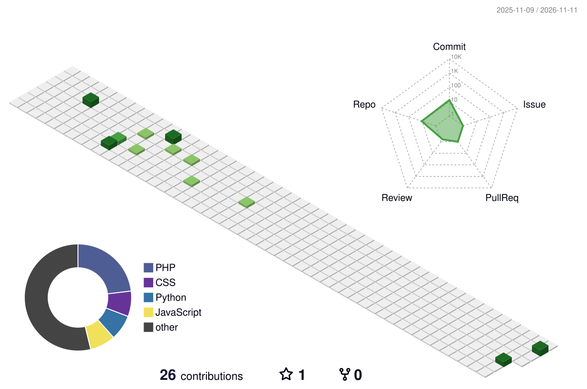

# Hi, I'm Iancecil 👋

### Software Engineer · Cloud Infrastructure Builder · Automation Practitioner

**From application code to the infrastructure that keeps it running.**

Nairobi, Kenya 🇰🇪 · Founder, Little Genius Tech

---

I build web applications, integrate AI into practical workflows, and operate self-hosted services. My work connects interfaces, APIs, automation, and deployment, with projects spanning tourism, nutrition, education, and business tools.

Through **Little Genius Tech** and developer communities, I also help people turn technical ideas into working software through hands-on learning.

## My year in 3D

Every tower represents a day of building. Height reflects my GitHub contribution activity.

<picture>
  <source media="(prefers-reduced-motion: reduce) and (prefers-color-scheme: dark)" srcset="./profile-3d-contrib/profile-night-green.svg">
  <source media="(prefers-reduced-motion: reduce)" srcset="./profile-3d-contrib/profile-green.svg">
  <source media="(prefers-color-scheme: dark)" srcset="./profile-3d-contrib/profile-night-rainbow.svg">
  
</picture>

Refreshed daily · Private contribution details stay private · [View contribution calendar](https://github.com/iancecil#year-list-container)

## What I'm building around

- **Products for everyday needs** — web experiences backed by useful APIs and services.
- **Self-hosted infrastructure** — containerized applications, routing, storage, and deployment workflows.
- **AI and automation** — LLM integrations, n8n workflows, and UiPath process automation.
- **Developer education** — workshops, technical sessions, and community events.

## Selected work

| Project | What it's about |
| --- | --- |
| **[SafariSite Africa](https://safarisite.africa)** | Discovering African safari operators and journeys through a travel discovery platform. |
| **[NutriDigi](https://nutri-digi.com)** | Kenyan recipes, nutrition content, and meal-planning tools. |
| **[Little Genius Tech Learning](https://learn.littlegeniustech.com)** | Technology education across cybersecurity, networking, cloud, and DevOps. |
| **[Self-hosted infrastructure](https://iancecil.cloud/#infrastructure)** | The deployment environment behind my applications, AI services, and automation tools. |

### Explore the code

- **[AI insurance prototype](https://github.com/iancecil/backend)** — a FastAPI backend exploring insurance workflows and an AI chat integration, with a companion **[React interface](https://github.com/iancecil/frontend)**.
- **[Resume-to-job matching](https://github.com/iancecil/AI-Project)** — a project pairing a Flask API with a React interface for CV-based job recommendations.
- **[Flutter + Firebase notes app](https://github.com/iancecil/flutter_firebase_app)** — a mobile app project exploring authentication, note management, and Firestore.

**[Browse my repositories →](https://github.com/iancecil?tab=repositories)**

## Tools I work with

| Area | Technologies |
| --- | --- |
| Applications & APIs | Python · JavaScript · React · FastAPI · Flask · PHP / Laravel |
| Infrastructure | Docker · Docker Compose · Coolify · Traefik · Cloudflare |
| Automation & AI | n8n · UiPath · LLM APIs · Qdrant |
| Mobile & data | Flutter · Firebase · SQLAlchemy · MinIO |

## Community & teaching

I've spoken, facilitated sessions, and hosted events in the UiPath student developer community, including:

- **[Build First Automation Process with Studio](https://community.uipath.com/events/details/uipath-africa-student-developers-presents-build-first-automation-process-with-studio/)** — speaker, August 2024.
- **[Exploring Generative AI with UiPath, Google & Microsoft 365](https://community.uipath.com/events/details/uipath-africa-student-developers-presents-bridging-innovation-exploring-generative-ai-with-uipath-google-and-microsoft-365/)** — facilitator and host, September 2024.
- **[UiPath Community Hack-A-Bot, Nairobi](https://community.uipath.com/events/details/uipath-africa-student-developers-presents-the-uipath-community-hack-a-bot-hackathon-nairobikenya/)** — host, October 2024.

## GitHub activity

My work spans public projects and private repositories. These stats reflect the contribution activity visible on my GitHub profile; private contributions appear only as anonymized counts when enabled.

<a href="https://github.com/iancecil#year-list-container">
  <picture>
    <source media="(prefers-color-scheme: dark)" srcset="https://streak-stats.demolab.com/?user=iancecil&amp;theme=github-dark-blue&amp;hide_border=true&amp;ring=14B8A6&amp;fire=14B8A6&amp;currStreakLabel=2DD4BF&amp;disable_animations=true&amp;timezone=Africa%2FNairobi">
    
  </picture>
</a>

[View my contribution calendar →](https://github.com/iancecil#year-list-container)

Contribution counts include eligible commits, issues, and pull requests. Updates can take up to 24 hours.

---

**Building a product, automating a workflow, or planning a developer session?**
[Let's talk](mailto:wiancecil64@gmail.com) · [Explore my portfolio](https://iancecil.cloud)
